<p align="center">
  <a href="https://leejunik.com"></a>
</p>

<p align="center">
  <a href="https://leejunik.com"><b>leejunik.com</b></a> ·
  <a href="mailto:zz262zzx@gmail.com">zz262zzx@gmail.com</a> ·
  <a href="https://velog.io/@juniqu_e">velog</a>
</p>

<br>

### `$ cat philosophy.md`

> **기술의 가치는 사람이 할 수 있는 일을 넓히는 데 있다고 믿습니다.**
>
> 생산성은 더 많은 일을 처리하는 것이 아니라, 시도하고 실현할 수 있는 일의 범위를 넓히는 것이라고 생각합니다. 안정적인 운영과 효율적인 구성, 자동화, 측정과 기록을 중요하게 생각하는 엔지니어입니다.

> **미래를 바꾸려면, 변화의 대가도 함께 선택해야 한다고 믿습니다.**
>
> 원하는 변화에는 시간과 노력, 익숙함을 내려놓는 대가가 따릅니다. 그 대가를 받아들이는 것까지가 선택이라고 생각합니다.

<br>

### `$ docker ps` — 직접 운영 중인 것들

| 서비스 | 하는 일 | 숫자 |
|---|---|---|
| **홈서버 인프라** | 리눅스 서버 1대 위에 컨테이너로 서비스를 올리고, 포트포워딩 없이 Cloudflare Tunnel로 공개 | 컨테이너 25 · 도메인 20+ · 인바운드 포트 0 |
| **[ccna.wnsdlr.com](https://ccna.wnsdlr.com)** | 시험 12일 전에 만들어 동기들과 함께 쓴 CCNA 문제은행 | 실사용자 22명 · 풀이 61,328 · 5xx 0.02% |
| **AI 지식관리 워크스테이션** | 사람과 AI가 같은 Obsidian 볼트를 동시에 편집해도 깨지지 않는 기록 시스템 | 강의노트 50+ · 개념 위키 165 · 동기화 실패 0 |
| **[leejunik.com](https://leejunik.com)** · [repo](https://github.com/juniqu-e/portfolio) | 이 포트폴리오. push 하면 GitHub Actions → GHCR → Watchtower로 홈서버에 배포 | |

<br>

### `$ ls ~/stack`

```text
server/cloud   Linux · Windows Server · Docker · Kubernetes · AWS · Cloudflare
operations     Nginx · Jenkins · Prometheus · Grafana
languages      Python · JavaScript · Java
tools          Git · Jira · Notion · Slack · Mattermost · Figma
```

<br>

### `$ journalctl -u junik`

```text
2026.10  CCNA 200-301 취득
2026.09  정보처리기사 취득
2026.07  RAPA 클라우드 보안 전문가 양성과정 — 네트워크 · 보안 · Windows/Linux Server · AWS
2025.06  SSAFY 13 · 14기 실습코치 — 교육생 개발환경 · CI/CD · 배포 기술지원 (1년)
2024.07  SSAFY 12기 Python 트랙 (1,600시간) — 팀 프로젝트 3회 모두 수상
```

`next` → **VMware VCP** — running
